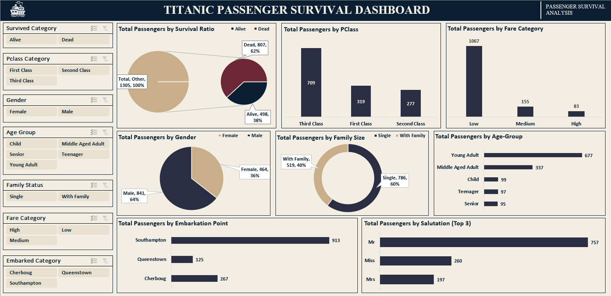

# Titanic Passenger Survival Analysis — Excel BI Dashboard

An end-to-end Excel analytics project: raw data cleaning (via both formulas and Power Query),
pivot-based analysis, and an interactive dashboard investigating what actually drove passenger
survival on the Titanic.

---

## Problem Statement

After the sinking of the Titanic, this project takes on the role of a data analytics
consultant investigating whether passenger survival was random or driven by identifiable,
structural factors. Built on a 1,309-passenger Titanic dataset
([source](https://www.kaggle.com/datasets/sakshisatre/titanic-dataset)), it translates raw
statistics into evidence-based, executive-style business conclusions.

**Why this project stands out:** rather than stopping at surface-level survival percentages,
this analysis stress-tests each pattern before presenting it, for example, catching that the
apparent "family boosts survival" effect is largely a gender-driven illusion once
disaggregated (a Simpson's Paradox check), and confirming Cherbourg's higher survival rate
holds up even after controlling for its First Class-heavy passenger mix. The dataset was also
cleaned two independent ways, manual formulas and Power Query, as a built-in accuracy
cross-check.

## Executive Summary

Only 38% of passengers survived. Survival was not random, it followed two reinforcing
patterns: economic status (class and fare) and evacuation priority (gender and age). First
Class passengers survived at more than double the rate of Third Class, and women survived at
nearly four times the rate of men. Family status initially looked like an independent driver,
but disaggregating by gender shows it mattered only for men. Because these variables were all
known before departure, they could plausibly have powered a predictive risk model in advance.

*(Full breakdown: see [insights.md](./insights.md))*

## Key Business Questions

1. Was survival random, or were certain passenger segments more likely to survive?
2. Did socio-economic status influence survival chances?
3. Did age, gender, or family size affect survival, and did crisis management favor particular groups?
4. Could survival likelihood have been predicted before departure using available passenger data?

## Key Insights

- **Class/Fare:** First Class 62% survived vs. Third Class 26%; High fare 71% vs. Low fare 32%
- **Gender:** Females 73% survived vs. Males 19% — the single strongest predictor
- **Age:** Male children (53%) far outperformed adult men (under 20%)
- **Family status:** Appears to raise survival (50% vs. 30%) — but this is gender-dependent;
  near-zero effect for women, a real +10pt effect for men
- **Embarkation port:** Cherbourg (55%) outperforms Southampton (33%) even within the same
  class band, pointing to a small independent port effect

Full reasoning and evidence for each point: [insights.md](./insights.md)

## Dashboard

Interactive elements: slicers for Class / Gender / Embarked / Family Status, filtering all
charts simultaneously — survival ratio, class distribution, fare distribution, gender split,
family size split, embarkation split, and salutation(top ones).

## Tech Stack

- Microsoft Excel (Power Query, PivotTables, PivotCharts, DAX-free formula layer)
- Data cleaning performed two ways for cross-validation: manual formulas + Power Query
- Conditional formatting for pivot-level visual scanning
- Dashboard built using slicers + chart objects

## Methodology

1. **Data Preparation** (source: 1,309-row Titanic dataset)
   - Converted binary `Survived` (0/1) into categorical `Alive` / `Dead`
   - Mapped `Pclass` (1/2/3) → First / Second / Third Class
   - Extracted salutation/title from the `Name` field
   - Removed 4 rare, single-occurrence salutation rows as noise
   - Imputed missing `Age` values with the average age (30), then built Age Group
   - Imputed the 1 missing `Fare` value with 0 (falls into "Low" fare category, matching the mode)
   - Imputed 2 missing `Embarked` values with the mode, Southampton
   - Built derived fields: Age Group, Family Size (`SibSp + Parch + 1`), Family Status
     (Single / With Family), Fare Category, Embarked Category
2. **Validation:** cleaning performed independently via formulas and via Power Query, cross-checked for consistency
3. **Analysis:** built 7 pivot tables covering survival by class, salutation, gender×age, fare, family status, and embarkation×class
4. **Dashboard:** translated pivot outputs into an interactive, slicer-driven visual layer

## Credits & Ownership

- Dataset: [Titanic Dataset](https://www.kaggle.com/datasets/sakshisatre/titanic-dataset) (Kaggle, public, 1,309 records)
- Analysis, dashboard design, and all insights: **Mariam Khan**
- [LinkedIn](https://linkedin.com/in/mariam-khan0424) · [GitHub](https://github.com/mariamkhan04)
- This project follows a business-case analytical framework developed as part of **(AI DataYard's Business Intelligence bootcamp)** exercise; methodology and business questions are documented above and in
  `insights.md`.